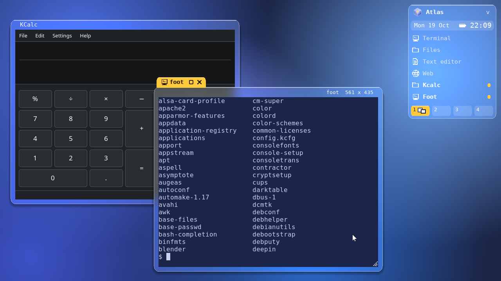
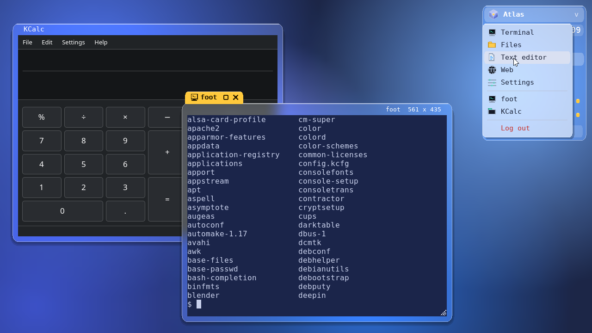
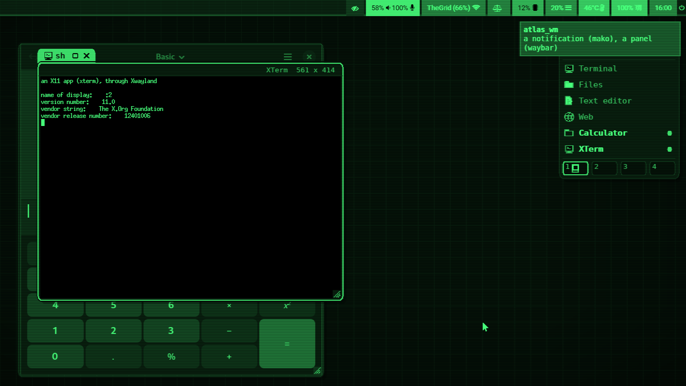
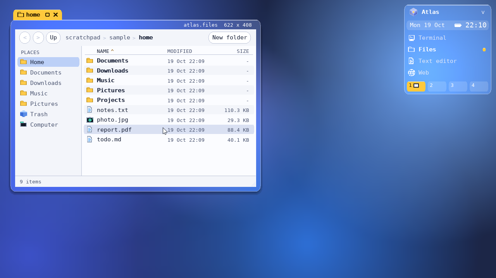
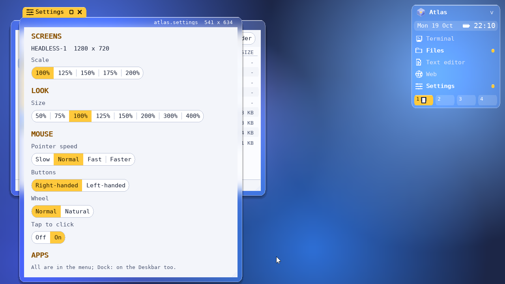
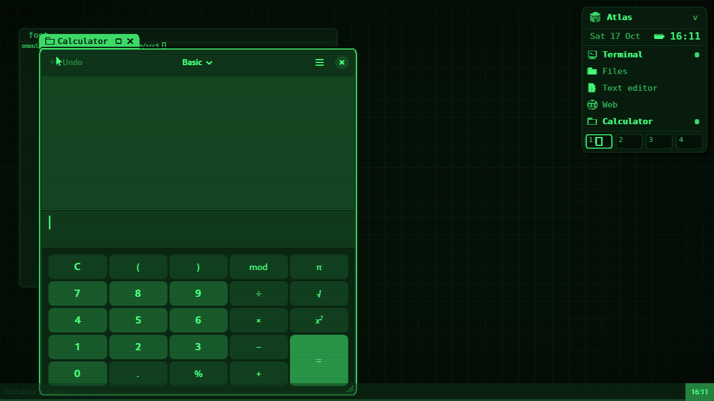

# atlas_wm

(c) Olivier Moulin. SPDX-License-Identifier: GPL-3.0-only

The Atlas desktop of [SIEOS](../sieos/docs/desktop.md) as a Wayland
compositor for Linux, on wlroots 0.18. Its windows have a **title tab** as
wide as their title, the **Deskbar** sits at the top right, there are **4
workspaces**, and it is all in SIEOS's **glass**: a deep navy desk lit by
blue glows, and windows, the Deskbar and menus of see-through glass. What
is behind the glass shows through it, blurred and more vivid, the glass's
tint laid over it. The focused window's tab is amber. Apps' windows keep
their own colours.



## Building

Debian 13 (trixie):

```
sudo apt install libwlroots-0.18-dev libwayland-dev wayland-protocols libxkbcommon-dev \
                 libpixman-1-dev libdrm-dev libegl-dev libgles-dev libinput-dev libxcb1-dev \
                 libxcb-icccm4-dev libpam0g-dev pkg-config xwayland foot
make
```

Two protocol files from wlr-protocols (layer shell, output power) are in
`protocol/`, since wayland-protocols does not ship them.

`foot` is optional: the Deskbar uses the first terminal it finds (foot,
GNOME Console, Alacritty, kitty, Konsole, GNOME Terminal).

## Running

- **In a window of your desktop** (to try it): `./atlas_wm` from a GNOME,
  KDE or sway session opens a window that is a whole Atlas desktop. Apps
  that keep one instance per D-Bus session (Nautilus, GNOME Text Editor)
  may open their window on your desktop instead; run
  `dbus-run-session ./atlas_wm` to give atlas_wm a session bus of its own.
- **As your session**: `sudo make install` installs `/usr/local/bin/atlas_wm`
  and `/usr/share/wayland-sessions/atlas.desktop` (its `Exec` the full path,
  so the login manager's `PATH` does not matter), which **GDM** and **SDDM**
  both list. Choose *Atlas* from the gear menu on GDM's login screen, or
  from the session menu on SDDM's. `sudo make uninstall` takes it all away.
- **From a text console** (Ctrl+Alt+F3, logged in): `dbus-run-session atlas_wm`.

`atlas_wm -s COMMAND` runs a command once it has started, for example
`atlas_wm -s foot`. Each line of `~/.config/atlas/autostart` also runs at the
start. Ctrl+Alt+Backspace, Super+Shift+E or *Log out* ends the session.

## The desktop

- **The tab** sits on the window's top left, as wide as its title. It holds
  the app's icon outline, the title in bold, then zoom (a square) and close
  (a plain x). The focused window's tab **rises** out of its frame in
  amber (220 ms, with a slight overshoot), its amber glowing in the glass
  under it. The others' tabs **sink** back into it (170 ms), leaving the
  title dim in the strip at the window's top. With the tab up, the strip's
  right side shows the app's id and size.
- **Drag** the tab, or the strip, to move a window. Double-click the tab to
  minimize it. Right-click it for *Minimize*, *Zoom*, *Full screen*, *Send
  to workspace N* and *Close*.
- **Resize** with the grip at the bottom right, or with any edge or corner.
  Super+drag moves a window from anywhere in it, and Super+right-drag
  resizes it.
- **Depth**: each window sits in a **rim of clear glass** (10 pixels at its
  sides and bottom, curving in under its top corners; the strip at its top
  is glass too) and casts a soft shadow below it (three shades, a little
  wider each, no blur). The focused window's shadow is deeper (five shades,
  further down); only its tab is amber. A window's glass shows the desk
  and the windows behind it, never its own insides. Atlas's terminal
  (Term) is smoked glass too: the desk shows through it, blurred, as in
  SIEOS. Settings is dimmed by 3/16 when it is not in focus; apps are shown
  as they draw themselves.
- **Motion**: a window opened, minimized or brought back sends a ghost of
  itself (a pane of light, its outline) between its box and its app's row
  on the Deskbar (200 ms, easing out); minimized, the row then pulses once
  in amber. A window fades in as it opens (140 ms). Switching workspaces,
  the windows slide an eighth of the screen sideways as they fade (out to
  the left for a later workspace).
- **Placement**: a new window goes down and to the right of the front one,
  so every tab stays in view. Dialogs are centred over their parent. Each
  kind of app opens at a size suited to it: browsers and editors are large,
  file managers narrower.
- **The Deskbar**: the cube's menu has the apps, every window (hidden ones
  marked), *Lock* and *Log out*. The tray has the date, the battery (on a laptop)
  and the clock; when windows ask for attention (an app's activation that
  did not come from the app with the keys, an X11 urgency hint), an amber
  pill "2 new" takes the date's place, and a click on it brings the latest.
  A window shown no longer asks. Below are the apps: a running one is bold with a lit dot
  (a ring when all its windows are hidden) and the number of its windows.
  A click brings its last window to the front (again: its next window), or
  starts the app. Right-click gives *New ...* and its windows. Apps that are
  not in the list get a row while they run. Last come the **workspaces**,
  each a small map of its windows.
- **The desk**: right-click it for a menu of the apps. A workspace with no
  window shows the time, large and dim, at the bottom right.



### Title bars

Atlas draws the decorations. An app that speaks xdg-decoration (Qt, foot,
Firefox, most terminals) or KDE's server-decoration (GTK 3) draws none of
its own. GTK 4 and libadwaita apps keep their header bar, because it holds
the app's own buttons (menus, modes, back). For those Atlas leaves out its
strip, so the app's bar is the window's top and the tab sits over it. It
also doesn't offer them minimize or maximize, so they hide those buttons;
the tab has zoom, and double-clicking it minimizes. X11 apps that ask for
no decorations (Motif hints) are treated the same way.

### X11 apps

Xwayland starts when the first X11 app connects. `DISPLAY` is set for
everything atlas_wm starts. X11 windows are windows like the others: tab,
frame, workspace and Deskbar row. Their menus and tooltips are drawn where
X puts them, over everything.

### Panels, wallpapers, notifications, lockers

wlr-layer-shell surfaces (waybar, swaybg, mako, fuzzel...) sit in four
layers:

- **background**: over the desk; a wallpaper hides it.
- **bottom**: under the windows.
- **top**: over the windows and the Deskbar.
- **overlay**: over everything but the menus.

A panel with an exclusive zone takes its room from the screen: windows,
zoom, the Deskbar and the rest clock keep clear of it. A launcher that asks
for the keys gets them; one that takes them on demand gets them when
clicked. Glass in front of them shows them, blurred, as it does windows.



### The lock screen

Super+L, or *Lock* in the cube's menu or the desk's, hides the session
behind SIEOS's lock screen: the time, large, in the middle of the desk, the
date under it, then a card with your initial in a circle, your name, the
password and an arrow to go in. Apps go on running behind it, but nothing
of them shows and no input reaches them; only Ctrl+Alt+Fn still works. Your
password opens it again. PAM checks it (the `atlas` service, which `make
install` puts in `/etc/pam.d`; `login` without it), in a process of its own,
so the screens never wait for the check. A wrong password shakes the card;
Caps Lock is said under the field.

`SIGUSR1` locks it too, so `swayidle` can lock before the computer sleeps
and after a while idle:

```
swayidle -w timeout 300 'pkill -USR1 -x atlas_wm' before-sleep 'pkill -USR1 -x atlas_wm'
```

Other screen lockers use ext-session-lock (`swaylock`, `gtklock`): every screen is
black under the locker, which alone gets the pointer and the keys. None of
Atlas's keys work then, except Ctrl+Alt+Fn. If the locker dies, the screens
stay black and locked; start another locker to get in. `swayidle` works
through ext-idle-notify (`swayidle timeout 300 swaylock`), and a video
player can hold the idle off (idle-inhibit). Screens turn off and on
through wlr-output-power-management (`wlopm`).

### Several screens

Each screen has its own room for windows, under its own panels. The
Deskbar is on the first. A window belongs to the screen that holds its
tab: new windows open on the pointer's screen, and zoom and full screen
fill the window's own screen. Drag a window by its tab onto another
screen. All screens switch workspace together. Arrange the screens with
`wlr-randr` (`wlr-randr --output HDMI-A-1 --pos 1920,0`) or `kanshi`. When
a screen goes away, its windows move to the nearest one.

### Files



`atlas-files` is Atlas's file manager, built and installed with it. It's
the Deskbar's *Files* and also opens a folder or a file given to it
(`atlas-files ~/Documents`). It is a Wayland app of its own: a slow
folder or a crash never touches the desktop. It draws with Atlas's display
list, so it has the same fonts, icons and colours, and its size from
`~/.config/atlas/look`; Atlas gives it its tab and frame. (Its menus'
glass is drawn as it shows over the desk's middle: a window cannot see
what is behind it.)

- **Folders:** *<* and *>* (Alt+Left, Alt+Right) go back and forward, *Up*
  (Backspace, Alt+Up) goes to the folder above. The path's parts are links;
  click after them or press Ctrl+L to type a path (`~` is home). **Places**:
  the home folders, drives mounted under `/media`, `/run/media` or `/mnt`,
  the Trash, the computer.
- **The list:** folders first, then by name (file2 before file10), kind,
  date or size: click a column's header, and again to reverse. Hidden files
  show with Ctrl+H. Letters typed jump to a name. The folder is watched, so
  what changes in it shows at once.
- **Choosing:** a click, Ctrl+click for one more, Shift+click (or
  Shift+arrows) for a range, Ctrl+A for all. Double-click or Enter opens: a
  folder in place, files with their app (`xdg-open`).
- **Doing:** F2 renames in place (the name chosen, its extension not). A
  right-click gives the menu, Ctrl+Shift+N a new folder, Ctrl+C / Ctrl+X /
  Ctrl+V copy, cut and paste (a name already taken gets " (copy)" or
  " (2)"). Delete moves to the Trash and Shift+Delete deletes for good,
  once asked. *Terminal here* is in the menu. Copies, moves and deletions
  run as `cp`, `mv` and `rm`, one after the other in processes of their
  own, so the window never waits; the status bar says how they went.
- **The Trash** is freedesktop's (`~/.local/share/Trash`), so other file
  managers share it. In it, *Restore* puts things back where they were and
  *Empty Trash* empties it.

### Keys

Super is the Windows key. Ctrl-based keys would collide with the apps.

| Keys | What they do |
|---|---|
| Super+T, Super+Return | a terminal |
| Super+W, Super+Q | close the window in focus |
| Super+Tab | the backmost window of this workspace comes in front |
| Super+1 .. Super+4 | a workspace |
| Super+Shift+1 .. 4 | send the window there |
| Super+Up | zoom (the whole desk beside the Deskbar), again: back |
| Super+Down | minimize |
| Super+F | full screen |
| Super+Space | the palette: type to find an app, a window, a file in your home, Settings, Lock or Log out, or run what you typed (arrows, Enter, Tab: run, Esc); nothing typed: the apps |
| Super+, | Settings |
| Super+L | lock the screen |
| Super+Shift+E, Ctrl+Alt+Backspace | quit |
| Ctrl+Alt+F1 .. F12 | another text console |

The keyboard layout comes from `XKB_DEFAULT_LAYOUT` (and `_VARIANT`,
`_OPTIONS`...). If that is not set, it comes from `/etc/default/keyboard`.

## Settings

*Settings* (Super+, , the cube's menu, or the desk's right-click menu) is a
window of Atlas's own, laid out as SIEOS's. Each choice is a segmented
control (the chosen option filled), and the wheel scrolls. Everything
applies at once and is kept in `~/.config/atlas`:

| Section | What | Kept in |
|---|---|---|
| Screens | each screen's mode (its sizes, the fastest refresh of each) and scale: 100%, 125%, 150%, 175%, 200%. A new one shows at once and **goes back by itself after 15 s** unless you press *Keep*, so a monitor that cannot show it is never a dead end. | `screens` |
| Look | the size of the desktop's own parts, 50% to 400% (windows keep their size on the screen); the look itself is glass, the only one | `look` |
| Mouse | pointer speed (Slow, Normal, Fast, Faster), right- or left-handed buttons, the wheel normal or natural, tap to click (touchpads) | `mouse` |
| Apps | the apps of the cube's menu, and with **Dock** which of them also have a row on the Deskbar; *Up*, *Down*, *Edit* (the name and the command, typed), *Remove*; **Add an app**: type a few letters of an installed app's name (the `.desktop` files of your, the system's and Flatpak's applications folders) and *Add* it (to the menu; *Dock* puts it on the Deskbar); or add one running, with the command it was started with | `apps` |



The files are plain text, so they can also be edited by hand:

```
# look
zoom=100           # 50 to 400 (%) (an older look= or web= line is ignored)
# screens: name, mode (width x height @ refresh in mHz), scale
eDP-1 1920x1080@60000 1.25
# mouse
speed=1            # 0 Slow .. 3 Faster
left=0
natural=0
tap=1
```

The environment variable `ATLAS_ZOOM` overrides the look file's size.

`~/.config/atlas/apps` holds the apps, one per line:
`name | icon | command | app_id | dock` (see `apps.example`); the last field
is `dock` (in the menu and on the Deskbar; the default) or `menu` (the
menu only, and a Deskbar row while it runs). The icons are
terminal, folder, editor, web, mail, settings, git, camera, app and window.
The app_id tells which windows belong to the app: it is what the tab's
row shows with a window's tab up. Without this file, the Deskbar lists the
terminal, file manager, text editor and web browser it finds.

### Scaling

Screens can have a fractional scale (Settings, `wlr-randr --scale 1.25`,
or kanshi). Apps that know wp-fractional-scale (GTK 4, Qt 6, foot,
Firefox, Chromium) draw at that scale and stay sharp; others are drawn at
the next whole scale and reduced. The desktop's own parts follow the
first screen's scale, times their size setting.

### Taskbars

External taskbars and docks see the windows through
wlr-foreign-toplevel-management (waybar's `wlr/taskbar`, sfwbar,
nwg-panel) and ext-foreign-toplevel-list. That includes each window's
title, app, screen and state (in focus, zoomed, minimized, full screen).
Their buttons bring a window to the front (its workspace with it),
minimize, zoom, make it full screen or close it.



## How it works

```
  apps ──surfaces──► the scene (wlroots) ──► the screen       (no glass in sight)
                       ▲  desk, windows,  └──► A, B ──glass.c──► the screen
  draw.c ──canvases──┘  the Deskbar, menus   (the glass over black, over white;
          (the chrome, drawn on the CPU)       what is behind it blurred, in GLSL)
```

| File | What it does |
|---|---|
| `main.c` | the compositor: protocols, the seat, keys, the pointer, timers |
| `output.c` | each screen's frame: straight from the scene, or with glass, the scene twice into our own swapchains, then glass.c; arranging and powering screens |
| `glass.c` | the glass: what is behind each piece of it, blurred, laid under it: fragment shaders (or the same on the CPU, under the pixman renderer) |
| `view.c` | the apps' windows (xdg-shell), their popups, the decorations, focus |
| `xwayland.c` | X11 apps through Xwayland |
| `layers.c` | panels, wallpapers, notifications, launchers (wlr-layer-shell) |
| `lock.c` | screen lockers (ext-session-lock), idling |
| `settings.c` | the Settings window: screens, size, mouse, the Deskbar's apps |
| `files/` | atlas-files: `wl.c` the window (a Wayland client: shm buffers at the screen's scale, input), `files.c` the file manager |
| `toplevels.c` | the window list for taskbars (wlr-foreign-toplevel, ext-foreign-toplevel-list) |
| `wm.c` | the window manager, from SIEOS's `wm.c`: tabs, placement, moving, resizing, workspaces |
| `deskbar.c` | the Deskbar, the desk, the menus, starting apps |
| `palette.c` | the palette (Super+Space): the apps, windows, files under the home folder (read in short slices), actions, a command |
| `chrome.c` | canvases as buffers of the scene (with glass: drawn over black and over white, and its masks); where they take the pointer |
| `draw.c`, `font*.c`, `icons.c`, `logo.c` | SIEOS's display list and rasterizer (with alpha), the desk's glows, its fonts, icons and logo (`logo.c` made from `logo-glass.svg` by `tools/mklogo.py`) |

- **The look** is SIEOS's. The desk is a deep navy lit by five wide glows,
  all blues, worked out at 1/16 of the screen and smoothed to each pixel
  (`draw.c`). Glass comes in three tints, each with an alpha: **clear** (a
  fifth white: the Deskbar, a window's frame and strip; white text and
  icons on it) and **milky** (menus; dark text). Each has a light
  edge and a bright line just inside its top; the amber accent is solid,
  with the same line.
- **The glass.** A canvas cannot see what is behind it, so a piece of
  chrome with glass in it is drawn twice: its glass over black (A: its
  tint alone, what the scene shows) and over white (B: its tint and all the
  light it lets through), and its mask is where they differ. Everything
  drawn over glass is a straight line in what is behind it, so with glass
  in sight the scene draws the frame both ways, into swapchains of our own
  (`wlr_scene_output_state_options.swapchain`), and each pixel becomes
  `A + (B - A) x vivid(blur(behind))`: B - A is how much of what is behind
  shows there, nothing where there is no glass. What is behind depends on
  whose glass it is, so `glass.c` cuts the glass into levels: the
  Deskbar's and the menus' (behind: every window), each window's whose
  glass is near a window below it (behind: the desk and the windows below
  it, up to six such windows), and all the others' (behind: the desk). Each
  level's "behind" and mask are drawn from the scene's own buffers, back to
  front, around that level's glass only. The blur is SIEOS's: a quarter of
  the size (4 x 4 pixels' mean), a tent 7 of those wide each way, across
  then down, then 1.7 times as saturated. With no glass on a screen (an app
  full screen), the scene draws straight to it.
- **The chrome** is drawn on the CPU by SIEOS's rasterizer: rounded boxes,
  frames, shades and text, with DejaVu Sans Mono rendered once (pixel for
  pixel at 100%, smooth at other zooms). Each window's frame is four bands
  around the app, plus the grip over the app's corner. So what the app
  covers is never drawn, and a shadow is black at a quarter alpha over
  whatever is behind. A band takes the pointer only where it has a click
  box: a window's shadow lets clicks through to what lies behind it.
- **Nothing runs when nothing happens**: there is a timer every 16 ms only
  while a tab, a ghost or a fade moves, and the clock once a minute. Fades
  and slides change the opacity and place of the window's buffers in the
  scene: nothing is drawn again. Frames
  are drawn only when something changed.

## Tests

`ATLAS_TEST=FIFO` makes atlas_wm read lines from that FIFO, as a hand would
drive the pointer: `move X Y` (layout pixels), `down B`, `up B` (1 left, 2
middle, 3 right). `dump` logs every window's box, workspace and state, and
`at X Y` logs what is at that point (an app's surface, a piece of chrome
and its click box, a window); `wheel N` scrolls N steps. It also turns on the virtual pointer and
keyboard protocols, for `wlrctl` and `wtype`. Run it headless
(`WLR_HEADLESS_OUTPUTS=2` for two screens):

```
mkfifo /tmp/atlas.fifo
WLR_BACKENDS=headless WLR_HEADLESS_OUTPUTS=1 ATLAS_TEST=/tmp/atlas.fifo ./atlas_wm -s foot &
echo "move 90 37" > /tmp/atlas.fifo; echo "down 1" > /tmp/atlas.fifo   # the tab
echo "move 390 187" > /tmp/atlas.fifo; echo "up 1" > /tmp/atlas.fifo   # dragged
echo dump > /tmp/atlas.fifo
WAYLAND_DISPLAY=wayland-1 grim shot.png                                 # screencopy: the frame as shown
```

## Not yet

- **Keyboard layouts** are not in Settings: they come from `XKB_DEFAULT_*`
  or `/etc/default/keyboard`.
- **Screen positions** are not in Settings: screens open side by side, and
  `wlr-randr` or kanshi move them.
